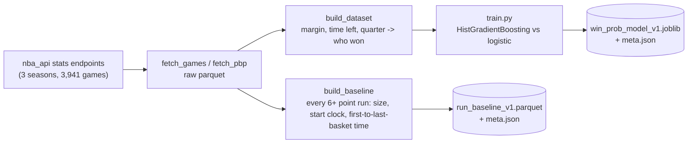
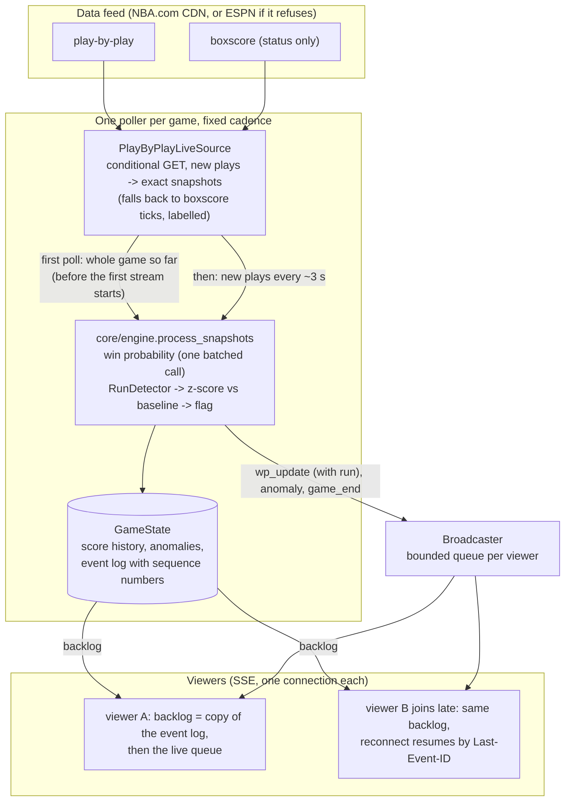

# Architecture

Two pipelines share one core engine. The historical pipeline runs once (or occasionally) offline and produces two artifacts; the live pipeline runs continuously in the server and uses them.

## Pipeline 1: historical (offline, `backend/historical/`)

The model only uses features that exist live (margin, time remaining, quarter), so train and serve can't drift. The baseline is built with the *same* `RunDetector` the live engine uses, and buckets each run by the clock where it started, so a live z-score is comparable to it. Both artifacts are committed under `data/artifacts/` and baked into the Docker image.

Evaluation scripts (`scripts/`) run finished games through the live engine and write `heat_check_backtest.json` and `win_prob_calibration_v1.json` next to the artifacts; `/api/model-info` serves them.

## Pipeline 2: live (in the server)

Key points:

- **One poller per game**, however many people watch, so cost doesn't grow with viewers (`scripts/load_test_sse.py`). A poller with no viewers stops itself after `LIVE_IDLE_STOP_SECONDS`.
- **Exact snapshots.** The live source turns every new play-by-play action into one `GameSnapshot(exact=True)`. The engine only ever sees snapshots, so replays (curated fixtures, past games built from play-by-play) and live games run the same code. A boxscore-poll snapshot (`exact=False`) is the labelled, lower-fidelity fallback.
- **Cadence.** Each cycle is scheduled against the start of the previous one (`next = start + interval`), so fetch time doesn't stretch the period. The source may suggest a longer interval when the feed is quiet.
- **No gap, no repeat.** Every emitted event gets a sequence number, is appended to the game's log and is published. A connection subscribes and copies the log with no `await` between, so the backlog and the queue partition the events exactly; `Last-Event-ID` resumes a dropped connection.
- **State outlives the poller.** When a poller stops, the state moves to a bounded cache (`STATE_CACHE_MAX_GAMES`, `STATE_CACHE_MAX_AGE_SECONDS`). A new poller for a game that can be backfilled rebuilds it from the start.

## Replay

`POST /api/replays/{id}/start` creates a session key `replay:{id}:{session}` and a `ReplaySource` over either a curated fixture or a past game's play-by-play (`app/nba/replays.py`). It goes through the same poller, engine, state and `/stream` endpoint as a live game; the state is removed when the replay ends.

## Where things are

| Path | What |
|---|---|
| `backend/app/core/engine.py` | snapshots -> win probability, run state, flags, events |
| `backend/app/datasources/nba_live.py` | the live play-by-play source and its boxscore fallback |
| `backend/app/polling/poller.py` | cadence, priming, retention, per-game stats |
| `backend/app/api/stream.py` | SSE: backlog, hand-off, `Last-Event-ID`, limits |
| `backend/app/anomaly/` | `RunDetector` and the baseline z-score |
| `backend/app/nba/` | NBA.com client (conditional requests), ESPN translator, demo data, weekly dashboard |
| `frontend/src/game-view.js`, `worm-chart.js` | the game page and chart (no build step; D3 vendored) |
| `scripts/` | backtest, calibration, SSE load test, ESPN fetch cache |
