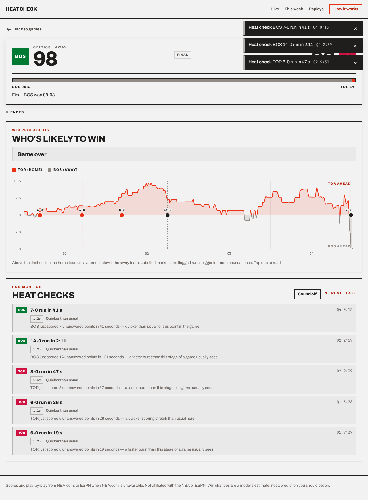
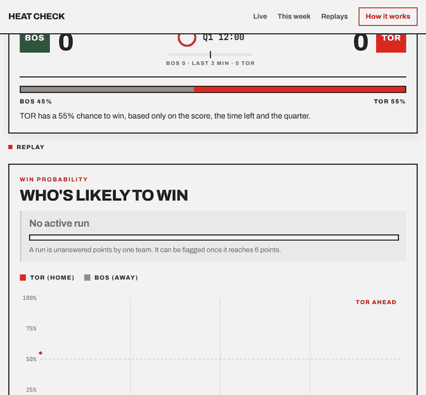
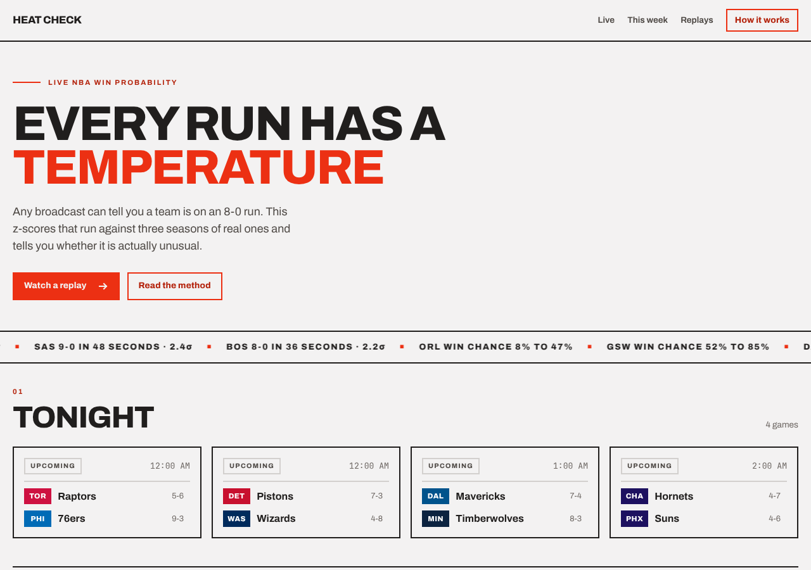

# Heat Check

**Live NBA win-probability tracking, with a statistical heat check on every scoring run.**

> **Live site:** not deployed yet. I couldn't deploy from the environment I built this in, so there is no URL to put
> here. [Deploying](#deploying) says what I'd do and what to check; put the link here once it's up.



*BOS @ TOR, 2026-11-11, replayed from ESPN's real play-by-play: win chance over the game, labelled markers for the five flagged runs, the run meter and the heat-check feed.*



Announcers call it a heat check when a player takes a contested shot just to prove he's still hot. This project runs the same check on the whole game: any broadcast can tell you a team is on an 8-0 run, but is that run actually unusual for this point in the game, or does it just feel that way?

## Why this exists

A real-time system built around one statistical idea: pool a baseline distribution from historical data, then z-score a new observation against it. Applied here to two things at once, as a game unfolds:

- **Win probability**: a model trained on historical score-margin / time-remaining / quarter data, recomputed on every play.
- **Anomaly detection on scoring runs**: how fast did this run happen compared with runs of the same size that started at the same stage of a game?

The engineering problem is per-game server-side state, Server-Sent Events, and a poll → recompute → flag → push pipeline that runs the same code whether it is driven by a live game or a replay. The NBA off-season (and most evenings) means there's often no live game to test against, so the system is built to be validated and demoed on replays first: see [Replay mode](#replay-mode).

## Quickstart

```bash
python -m venv .venv
.venv/Scripts/activate        # Windows; use .venv/bin/activate on macOS/Linux
pip install -r requirements.txt

uvicorn app.main:app --app-dir backend --reload
# -> http://127.0.0.1:8000            (frontend)
# -> http://127.0.0.1:8000/docs       (interactive API docs)
```

No network, or no games today? Run with generated sample data:

```bash
HEAT_CHECK_DATA=demo uvicorn app.main:app --app-dir backend --reload
```

Demo mode serves fictional players on real team codes, random scores and a synthetic play-by-play, so the whole UI works offline. Its two "live" games stream archived replay fixtures at 10x (and, like the real source, give a late viewer everything that has happened so far). Every response carries `mode: "demo"` and the page shows a "Sample data" banner.

Run the test suite:

```bash
pytest
```

## How it works

### Data sources

- **Live**: NBA.com's public CDN (`cdn.nba.com/static/json/...`), fetched with `httpx` (`backend/app/nba/client.py`): today's scoreboard, the season schedule, and per-game boxscore and **play-by-play**. cdn.nba.com answers HTTP 403 to some cloud hosts, so when it refuses, the app falls back to ESPN's public site API (`backend/app/nba/espn.py`), translated into the same shapes so the rest of the app is unchanged. `NBA_SOURCE=nba` or `NBA_SOURCE=espn` pins one source. `/api/nba-check` on a deploy shows what each source returns from that host. `stats.nba.com` is not used (it blocks most cloud hosts).
- **Historical**: `nba_api`'s stats endpoints, pulled once per season to train the win-probability model and build the anomaly baseline (`backend/historical/`).

### Architecture

Two pipelines share one core engine; [ARCHITECTURE.md](ARCHITECTURE.md) has the diagrams.

1. **Historical pipeline** (run once/occasionally): trains a win-probability model restricted to *only* the fields available live (score margin, time remaining, quarter) and builds a run-size-vs-game-clock baseline table for z-scoring runs.
2. **Live pipeline**: one poller per tracked game reads the play-by-play feed, turns every new play into an exact snapshot, feeds each through the shared engine (`backend/app/core/engine.py`), and pushes win-probability and heat-check events to every connected viewer over SSE.

### Heat checks come from play-by-play

Earlier versions detected runs from boxscore *score deltas between polls*. With one boxscore every ~12 s, both teams scoring inside one window was common, and that window was treated as unorderable, so real runs were cut short and never reached the minimum size. The same game flagged 0 runs at one sampling rate and 1 at another.

Now the live source reads the play-by-play and the engine sees one snapshot per action, so a run is built from true scoring plays with their real clock. Two things follow, both tested:

- **The result doesn't depend on polling cadence.** The same game fed one play at a time, a dozen per poll, or all at once flags the same runs at the same times with the same z-scores (`test_play_by_play_flags_do_not_depend_on_polling_cadence`).
- **A run is scored the way the baseline was built**: bucketed by the clock where it *started* and timed from its first to its latest basket. (Before, it was bucketed and timed by whichever poll noticed it.)

If play-by-play can't be had (the CDN refuses it, or the feed is empty for a game that has scored) the source falls back to boxscore polls and says so: every event carries `fidelity: "boxscore_ticks"` and the game page shows an "Approximate mode" badge. That path keeps the old weakness (`test_boxscore_ticks_depend_on_sampling`).

### Late viewers get the whole game

The first poll of a game reads the whole play-by-play so far and runs every play through the engine *before the first viewer's stream starts*, so even the first visitor sees the full chart and every heat check that already happened. Every event has a sequence number (the SSE `id`), and a game's event log is what a late viewer's backlog is built from, so it matches exactly what a viewer who was there from the start received. A reconnecting browser sends `Last-Event-ID` and gets only what it missed. When a poller stops (game over, or nobody watching), the game's state stays in a bounded cache (20 games or 24 h, whichever comes first), so revisiting a finished game still shows everything.

### Dashboard

The home page (`frontend/`, no build step) shows, top to bottom:

- **Tonight**: today's games from the scoreboard, refreshed every 15 s while the tab is visible. Live games link to their game page; games the server has followed show a heat-check count.
- **Moments of the week**: the plays that moved win chance the most ("Biggest swings") and the most unusually quick unanswered runs ("Hottest runs") from the last 7 days of finished games.
- **Results**: each of the week's games with its top performer, lead changes and largest lead.
- **Best performances**: the week's top 10 single-game lines by Game Score, points/rebounds/assists leaders, and the best average Game Score over 2+ games.
- **Replay a classic game** and **How the numbers work** (including the calibration curve and the threshold backtest, read from `/api/model-info`).



The week is built in the background (`backend/app/nba/weekly.py`) from each finished game's boxscore and play-by-play, 6 games at a time. A finished game's analysis is cached for the life of the process and the aggregate is refreshed every 10 minutes.

### The game page

`#/live/<id>` or `#/replay/<id>?speed=10`: the score, a win-chance bar, a **run meter** ("IND on a 6-0 run, 38 s" with a gauge that fills toward the heat-check line and changes style once flagged; sent on every update, so there is always something to show), the win-probability chart with labelled, tappable markers ("8-0"), a **heat-check feed** (team, "N-0 run in M s", rarity, z-score, game clock), a toast when a heat check lands live (sound is off by default), and a status line: Live / Reconnecting / Stalled / Ended, seconds since the last play, and the feed delay.

### Replay mode

Any game that finished in the last week (or earlier today) can be replayed from the dashboard: the server turns its play-by-play into the same snapshot sequence the live source produces and runs it through the same engine, so you see the win chance and heat checks unfold as they would have. Only games the server already knows finished can be replayed. The three curated fixtures in `data/replay_fixtures/` are one snapshot per play-by-play row, so they run the same way. (An earlier version of this README said they tick every ~3 s; that was wrong.) Replay is how this was built, validated and demoed during the off-season.

### API

| Endpoint | Purpose |
|---|---|
| `GET /api/scoreboard` | Today's games (live, then upcoming, then final), with `mode`, `source`, whether each is `tracked`, and `heat_checks` (a count, or null if the server isn't following it); 503 with a readable message if the data source is unreachable |
| `GET /api/dashboard/week` | `{"status": "building", "progress"}` while the week is being read, then the weekly dashboard payload |
| `GET /api/nba-check` | Diagnostics: direct requests to NBA.com (scoreboard, schedule, boxscore, play-by-play) and ESPN (scoreboard, a game summary), with status code, timing and the error for each, plus which source is in use |
| `GET /api/model-info` | Held-out model numbers, baseline size, the calibration curve and the threshold backtest (null until the scripts in `scripts/` have been run) |
| `GET /api/games/live` | Today's game IDs (kept for compatibility) |
| `GET /api/games/{game_id}/state` | Compact non-streaming snapshot of a tracked or recently finished game |
| `GET /api/games/{game_id}/lag` | Poll, fetch and publish timings and recent feed delays for a tracked game (see [Latency](#latency)) |
| `GET /api/games/{game_id}/stream` | SSE stream of `wp_update` / `anomaly` / `game_end` / `degraded` / `heartbeat` events. A live game starts being tracked on its first connection; the id must be on today's scoreboard (404) unless the server still holds that game; at most `MAX_CONCURRENT_LIVE_GAMES` are followed (429) |
| `GET /api/replays` | Available replay fixtures |
| `POST /api/replays/{game_id}/start?speed=N` | Start a replay session, streamed via the same `/stream` endpoint. Rate-limited per client |
| `GET /health` | Health check |

Every `wp_update` carries the run in progress (`run`, or null), `fidelity`, `source_ts` (when the feed says the play happened), `server_ts` (when this server sent it) and `feed_delay_sec` (the difference, only for plays seen live). Full interactive docs at `/docs` once running.

### Configuration

Every environment variable, with its default. None are required.

| Variable | Default | What it does |
|---|---|---|
| `HEAT_CHECK_DATA` | `live` | `demo` serves generated sample data, offline |
| `NBA_SOURCE` | `auto` | `auto`: NBA.com first, ESPN if it refuses; `nba` or `espn` pins one |
| `NBA_BROWSER_HEADERS` | `1` | Send a `Referer`/`Origin` of nba.com to cdn.nba.com. **Unverified** (see below); `0` turns it off |
| `LIVE_POLL_INTERVAL_SECONDS` | `3` | Poll interval for a live game while play is running (ESPN: at least 5) |
| `LIVE_IDLE_POLL_SECONDS` / `LIVE_DEEP_IDLE_POLL_SECONDS` | `10` / `15` | Interval when the feed is quiet (45 s+ with no new play, or a period just ended) / very quiet (120 s+, halftime) |
| `BOXSCORE_REFRESH_SECONDS` | `10` | How often the boxscore is read for game status |
| `POLL_BACKOFF_MAX_SECONDS` | `60` | Longest wait after repeated failed polls |
| `POLL_INTERVAL_SECONDS` | `12` | Pace of a *replay*: one step per this many seconds divided by the speed |
| `ANOMALY_Z_THRESHOLD` | `1.0` | z-score at which a run is flagged (see [What the numbers mean](#what-the-numbers-do-and-dont-mean)) |
| `ANOMALY_MIN_MAGNITUDE` | `6` | Smallest run, in points, that can be flagged |
| `MAX_CONCURRENT_LIVE_GAMES` | `6` | Live games followed at once (429 beyond) |
| `LIVE_IDLE_STOP_SECONDS` | `120` | A poller with no viewers stops itself after this long |
| `STATE_CACHE_MAX_GAMES` / `STATE_CACHE_MAX_AGE_SECONDS` | `20` / `86400` | How many stopped games' states are kept, and for how long |
| `SSE_HEARTBEAT_SECONDS` | `10` | Heartbeat on an idle stream (keep ≤ 15) |
| `SSE_RETRY_MS` | `3000` | Reconnect delay hinted to browsers |
| `MAX_STREAMS_PER_IP` / `MAX_TOTAL_STREAMS` | `30` / `500` | Concurrent stream limits (429) |
| `REPLAY_STARTS_PER_MINUTE` / `MAX_CONCURRENT_REPLAY_SESSIONS` | `10` / `10` | Replay limits (429) |
| `CORS_ALLOW_ORIGINS` | *(empty)* | Comma-separated origins allowed to call the API cross-origin. Empty means same-origin only; the bundled frontend needs no CORS |
| `LOG_LEVEL` / `LOG_FORMAT` | `INFO` / `text` | `DEBUG` also logs why each candidate run was not flagged; `json` for one JSON object per line |
| `PREWARM_WEEK` | `1` | Build the weekly dashboard when the server starts (`0` turns it off) |
| `WEEKLY_WINDOW_DAYS` / `WEEKLY_REFRESH_SECONDS` / `WEEKLY_RUN_MIN_Z` | `7` / `600` / `2.0` | Weekly dashboard window, refresh and "hottest runs" cut-off |
| `PORT` | `8000` | Set by most hosts; the Docker image listens on it |

## Latency

The page can't be faster than the NBA's own feed, so I don't claim "real-time" or "zero latency". What I did and what I know:

- **Changed**: a live game is polled every 3 s (it was ~12 s), scheduled against a fixed cadence so fetch time no longer adds to the period, with conditional requests so an unchanged feed is a 304, and eased off to 10-15 s when play is stopped. The SSE route sets `Cache-Control: no-cache` and `X-Accel-Buffering: no`, and is kept out of gzip. By arithmetic, polling now adds on average about 1.5 s (half the interval) and at most 3 s on top of the age of the feed's newest play; the old loop added on average ~6 s and up to ~12 s plus the fetch time.
- **Measured here** (local server, demo data): the engine plus handing events to subscribers takes about 3 ms per poll (`last_publish_ms`); 100 simultaneous clients on one game cost one poller (14 polls in 15 s, against 13 for a single client) and the first event reached them in a median of 0.69 s, mostly the ~340-event backlog each was sent (`scripts/load_test_sse.py`).
- **Reported live** (once a game is on): `feed_delay_sec` on each update, the "Feed delay ≈ N s" figure on the game page, and `/api/games/{id}/lag` (poll duration, fetch duration, feed age, publish time). The delay is when the feed says a play happened to when this server sent it. It excludes the TV broadcast delay and your own network.
- **Not measured**: the feed delay of a real in-progress game. None was on while I built this (tonight's games were hours from tip-off), and cdn.nba.com is not reachable from my build environment. **I have no real feed-delay number yet.** Run a live game, open `/api/games/{id}/lag`, and record the result here.

## Status

- **Done and tested**: the historical pipeline and trained artifacts (3,941 games; HistGradientBoosting, 74.7% accurate across all game states of the held-out 2025-26 season, log loss 0.477 vs 0.496 for logistic regression; the 96.3% "buzzer-convergence" figure measured the last play of each game, so it is a sanity check, not an accuracy number); the run baseline (33,761 real 6+ point runs, log-transformed durations); the engine, run detector and z-scoring; play-by-play-driven live and replay paths; backfill and the bounded state cache; fixed-cadence polling with conditional requests; the SSE transport; the dashboard and game page; the threshold backtest and calibration check. 166 tests pass.
- **Verified against real data**: ESPN's scoreboard, summary (boxscore and plays), pre-game summary and a full weekly dashboard build (49 real games) from this environment, through the app's own client; the live source and engine on a real finished game's 495 plays, including backfill-equals-streaming. Real captures are in `backend/tests/fixtures/`.
- **Not verified**: anything against `cdn.nba.com` (it answers 403 from my build environment, with or without the browser-like `Referer`/`Origin` headers added to the client; those headers are unconfirmed); ESPN or NBA.com while a game is *in progress*; the Docker image (no Docker daemon here; CI builds it, and a clean venv from `requirements-runtime.txt` boots the app in the image's layout); a deployed instance, including holding an SSE stream open for 10+ minutes behind a host's proxy; the pending `test_real_saved_boxscore_parses` (needs a real `cdn.nba.com` boxscore saved to `backend/tests/fixtures/boxscore_real.json`).
- **Open**: a pre-game team-strength prior (every game still starts near 50%); recap-card export; a `LICENSE` (the owner's choice).

### Loading speed

The weekly dashboard is built in the background as soon as the server starts (`PREWARM_WEEK=0` turns that off). Responses are gzipped (not the live streams), the vendored D3 and font are cached by browsers for a week, and D3 is only loaded on game pages.

## What the numbers do and don't mean

- **Win chance accuracy.** On the held-out 2025-26 season the model's favourite won 74.7% of the time across all 665,170 game states, with log loss 0.477 against 0.496 for logistic regression (`data/artifacts/win_prob_model_v1.meta.json`, served by `/api/model-info`).
- **Calibration.** Does "70%" mean 70%? On 170 finished 2026-27 games the model never saw (`scripts/calibration_check.py`), the Brier score is 0.1645 (always saying 50% scores 0.25; the held-out 2025-26 score is 0.1621), log loss 0.482, accuracy 73.6%. Predicted and observed rates track each other, with the home team winning a little less often than predicted in the 50-70% range. The states of one game share an outcome, so this is 170 games' worth of evidence, not 50,346 states'.
- **No team strength.** The model sees only score margin, time remaining and quarter. Every game starts near 50%, whoever is playing.
- **The heat-check threshold is tuned for how often games get a flag, not validated.** `scripts/backtest_heat_checks.py` replays the same 170 games through the live engine. Flags per game:

  | z ≥ | mean | median | p90 | max | games with none |
  |---|---|---|---|---|---|
  | 1.0 | 1.76 | 2 | 3 | 6 | 15% |
  | 1.5 | 0.79 | 1 | 2 | 4 | 45% |
  | 2.0 | 0.28 | 0 | 1 | 3 | 76% |
  | 2.5 | 0.11 | 0 | 0 | 3 | 91% |
  | 3.0 | 0.05 | 0 | 0 | 2 | 96% |

  I changed the default from 1.5 (tuned on three games) to **1.0**, the only level where a typical game gets a flag. At 1.0 a flagged run is about one standard deviation quicker than the baseline for its size and stage: "quicker than usual", not "rare", and the wording says so (it gets stronger only at 2.5+). This counts flags; it does not show that a flagged run matters. It is three weeks of early-season games from one source. Raise `ANOMALY_Z_THRESHOLD` for fewer, more striking flags.
- **The run baseline overlaps the model's test season.** It was built from 2023-24, 2024-25 and 2025-26; 2025-26 is the season the win-probability model was tested on. (The games in the backtest and calibration check are from the current season, which neither saw.)
- **Big runs have little history.** The baseline holds very few runs of 18+ points (some buckets have one run and zero spread, which can't be scored). The weekly "Hottest runs" score a long run on its longest opening stretch that has at least 50 historical runs behind it; the live engine flags a run when it first crosses the threshold, usually well below that size, and a run that keeps growing is still one flag. Pooled fallbacks (`period_pooled`, `global`, reported as the event's `bucket`) are an unweighted average of buckets and are approximate.
- **Corrections aren't re-read.** Both feeds are append-only lists in game order; a correction to a play already read (a score that is later revised) is not picked up. Notably, ESPN's `sequenceNumber` is *not* increasing along its list (seen in a real capture), so plays are tracked by list position.
- **Swings** measure a single play: win chance just before vs just after it, at the same clock.
- **Parser verification.** ESPN's field mapping was checked against real responses (above). The NBA.com CDN field names were checked against the sample payloads that ship with `nba_api` 1.11.4 (`nba_api/live/nba/endpoints/*.py`), including `playbyplay_{id}.json` (lower-case `playbyplay`, as `nba_api` requests it). They have **not** been checked against a real CDN response.

## Hardening

- **SSE backlog/live hand-off** (`app/api/stream.py`): every event has a sequence number; a connection subscribes to the live queue and copies the game's log with no `await` between, so the backlog is exactly the events up to a point and the queue holds exactly what follows; `Last-Event-ID` resumes. (Earlier, a timestamp comparison could drop an event that shared the last backlog timestamp.)
- **Duplicates on reconnect**: the chart ignores older and same-moment points, the feed ignores a heat check it already has, and the server sends only what `Last-Event-ID` hasn't covered.
- **Bounded memory**: finished and idle games are kept in a cache bounded by count and age (active games are never evicted); replay sessions are removed when they end; subscriber queues are bounded and a client that stops reading is dropped (and catches up on reconnect).
- **Abuse limits**: per-client and total concurrent streams, per-client replay starts per minute, a cap on concurrent replay sessions and live games. Behind a proxy these need the real client address, which the Docker `CMD` gets via `--proxy-headers`.
- **CORS** is off unless `CORS_ALLOW_ORIGINS` is set; the bundled frontend is same-origin.
- **Errors**: unhandled errors return `{"detail": "Internal server error"}`; tracebacks go to the log only. Logging has levels and an optional JSON format.
- **Degraded**: a `degraded` event after three failed polls is shown on the game page ("The data source isn't responding right now. Still trying…").
- **CI** (`.github/workflows/test.yml`): runs the tests, and builds the Docker image from a clean checkout, starts it in demo mode and hits it.

## Deploying

Everything is in the Docker image (`Dockerfile`, `render.yaml`): it installs `requirements-runtime.txt`, copies the trained artifacts, the replay fixtures and the frontend (with D3 and the font vendored), binds to `$PORT`, and runs `uvicorn app.main:app --app-dir backend --host 0.0.0.0 --port $PORT`. Health check path: `/health`.

Before you rely on a deploy:

1. Open `/api/nba-check` on it. If NBA.com is 403 from the host, the app uses ESPN automatically (`source_in_use` says which); if *both* are blocked, move to a host where one works (Fly.io, Railway or a small VPS are options to evaluate) or put a small relay in front, and note which here. I couldn't test either from a hosted environment.
2. Free tiers that sleep when idle give the first visitor a cold start of up to a minute (the model and baseline load, and the weekly dashboard builds in the background), and some cut long-lived connections. The browser reconnects and resumes by `Last-Event-ID`, but hold one stream open for 10+ minutes on the real host and check.
3. During a live game, open `/api/games/{id}/lag` and record the feed delay in [Latency](#latency).

## Re-running the evaluations

```bash
python scripts/backtest_heat_checks.py --fetch-days 30    # needs network; caches games in data/backtest_cache/
python scripts/calibration_check.py                       # reuses that cache
MAX_STREAMS_PER_IP=1000 HEAT_CHECK_DATA=demo uvicorn app.main:app --app-dir backend &
python scripts/load_test_sse.py --base http://127.0.0.1:8000 --clients 100 --seconds 20
```

## Caveats

- The in-memory single-process `GameStateStore`/`Broadcaster`, and the pandas-filter-per-lookup in `app/anomaly/baseline.py`, are deliberate v1 scope choices with a stated migration path (Redis-backed store, etc.).
- NBA.com's CDN has no documented rate limit or SLA. Each followed game costs one play-by-play request every ~3 s (a 304 when nothing changed) plus a boxscore every ~10 s, one poller per game however many people watch.
- ESPN's summary is the whole game in one ~450 KB response, so a live ESPN game is polled at most every 5 s.
